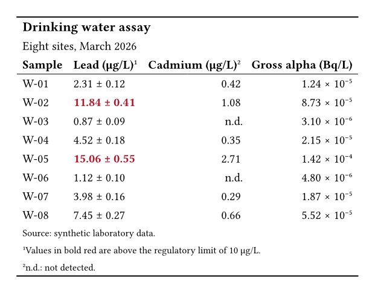

Laboratory reports and monitoring returns list their samples in this shape.
Both tables below start from the same data dictionary.

## The output

::: {layout-ncol=2}

{fig-alt="A booktabs table titled Drinking water assay, with eight samples. The Lead column shows each value plus or minus its uncertainty, and the two results over 10 are bold and red. Cadmium shows n.d. for two samples, and Gross alpha uses scientific notation."}

{fig-alt="The same assay table, built in native Typst, with the same uncertainties, red results, n.d. cells, and scientific notation."}

:::

## What Keisen does for you

- Joins each value to its uncertainty with one `columns-combine`.
- Writes the small activity values in scientific notation.
- Replaces each missing value with n.d. through one directive.
- Marks each result over the limit, chosen by a predicate on the data.

## The source

:::: {.column-page layout-ncol=2}

::: {}

**Keisen**

```typst
#import "@preview/keisen:0.1.0": *

#let data = (
  sample: ("W-01", "W-02", "W-03", "W-04", "W-05", "W-06", "W-07", "W-08"),
  lead: (2.31, 11.84, 0.87, 4.52, 15.06, 1.12, 3.98, 7.45),
  lead-error: (0.12, 0.41, 0.09, 0.18, 0.55, 0.10, 0.16, 0.27),
  cadmium: (0.42, 1.08, none, 0.35, 2.71, none, 0.29, 0.66),
  activity: (
    0.0000124,
    0.0000873,
    0.0000031,
    0.0000215,
    0.000142,
    0.0000048,
    0.0000187,
    0.0000552,
  ),
)

#display-table(
  data,
  table-header(
    title: [Drinking water assay],
    subtitle: [Eight sites, March 2026],
  ),
  table-stub(rowname: "sample", label: [Sample]),
  format-number(("lead", "lead-error", "cadmium"), decimals: 2),
  format-scientific("activity", decimals: 2),
  substitute-missing("cadmium", replacement: [n.d.]),
  columns-combine(
    "lead-result",
    ("lead", "lead-error"),
    (value, error) => [#value ± #error],
    label: [Lead (µg/L)],
  ),
  columns-label(cadmium: [Cadmium (µg/L)], activity: [Gross alpha (Bq/L)]),
  table-style(
    style(text: (fill: rgb("#b2182b"), weight: "bold")),
    locations: cells-body(columns: "lead-result", rows: row => row.lead > 10),
  ),
  table-footnote(
    [Values in bold red are above the regulatory limit of 10 µg/L.],
    locations: cells-column-labels(columns: "lead-result"),
  ),
  table-footnote(
    [n.d.: not detected.],
    locations: cells-column-labels(columns: "cadmium"),
  ),
  table-source-note([Source: synthetic laboratory data.]),
  theme: theme-booktabs(),
)
```

:::

::: {}

**Native Typst**

```typst
#let data = (
  sample: ("W-01", "W-02", "W-03", "W-04", "W-05", "W-06", "W-07", "W-08"),
  lead: (2.31, 11.84, 0.87, 4.52, 15.06, 1.12, 3.98, 7.45),
  lead-error: (0.12, 0.41, 0.09, 0.18, 0.55, 0.10, 0.16, 0.27),
  cadmium: (0.42, 1.08, none, 0.35, 2.71, none, 0.29, 0.66),
  activity: (
    0.0000124,
    0.0000873,
    0.0000031,
    0.0000215,
    0.000142,
    0.0000048,
    0.0000187,
    0.0000552,
  ),
)

#let fixed(value, digits) = {
  let text = str(calc.round(value, digits: digits))
  let parts = text.split(".")
  let decimals = parts.at(1, default: "")
  parts.at(0) + "." + decimals + "0" * (digits - decimals.len())
}

#let scientific(value, digits) = {
  let exponent = calc.floor(calc.log(value))
  [#fixed(value / calc.pow(10, exponent), digits) × 10#super[#str(exponent).replace("-", "−")]]
}

#let body = ()
#for row in range(data.sample.len()) {
  let lead = (
    fixed(data.lead.at(row), 2) + " ± " + fixed(data.lead-error.at(row), 2)
  )
  let cadmium = data.cadmium.at(row)
  body += (
    data.sample.at(row),
    if data.lead.at(row) > 10 {
      text(fill: rgb("#b2182b"), weight: "bold", lead)
    } else { lead },
    if cadmium == none { [n.d.] } else { fixed(cadmium, 2) },
    scientific(data.activity.at(row), 2),
  )
}

#table(
  columns: 4,
  align: (start, start, end, end),
  stroke: none,
  inset: 0.45em,
  table.hline(stroke: 1pt),
  table.cell(colspan: 4, align: start, text(
    size: 1.1em,
    weight: "bold",
  )[Drinking water assay]),
  table.cell(colspan: 4, align: start)[Eight sites, March 2026],
  table.header(
    [*Sample*],
    [*Lead (µg/L)*#super[1]],
    [*Cadmium (µg/L)*#super[2]],
    [*Gross alpha (Bq/L)*],
    table.hline(stroke: 0.5pt),
  ),
  ..body,
  table.cell(colspan: 4, align: start, text(
    size: 0.8em,
  )[Source: synthetic laboratory data.]),
  table.cell(colspan: 4, align: start, text(
    size: 0.8em,
  )[#super[1]Values in bold red are above the regulatory limit of 10 µg/L.]),
  table.cell(colspan: 4, align: start, text(
    size: 0.8em,
  )[#super[2]n.d.: not detected.]),
  table.hline(stroke: 1pt),
)
```

:::

::::

## Learn more

- [Report an estimate with its error](../examples/estimate-with-its-error.qmd).
- [Mark a cell that fails a threshold](../examples/mark-a-failing-cell.qmd).
- [Write values in their own notation](../examples/values-in-their-own-notation.qmd).
- [Formatters reference](../reference/formatters.qmd).
- [Table parts reference](../reference/table-parts.qmd).
- [Themes reference](../reference/themes.qmd).
