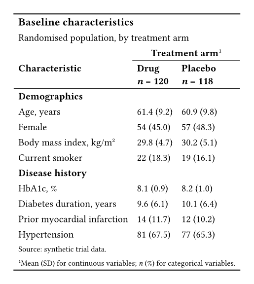

A randomised trial report opens with this table, so that a reader can see that the arms started alike.
Both tables below start from the same data dictionary.

## The output

::: {layout-ncol=2}

{fig-alt="A booktabs table titled Baseline characteristics. A Treatment arm spanner with footnote mark one covers the Drug and Placebo columns, each labelled with its size. Rows are grouped under Demographics and Disease history, and each cell shows a value with its spread in brackets."}

{fig-alt="The same baseline characteristics table, built in native Typst, with the same spanner, row groups, values, and footnote."}

:::

## What Keisen does for you

- Rounds each mean and each spread to one decimal place, and keeps the trailing zeros.
- Joins each value to its spread with one `columns-combine` for each arm.
- Groups the rows from the `section` column, so the body needs no loop and no running state.
- Numbers the footnote mark and writes the note in the footer.

## The source

:::: {.column-page layout-ncol=2}

::: {}

**Keisen**

```typst
#import "@preview/keisen:0.1.0": *

#let data = (
  section: ("Demographics",) * 4 + ("Disease history",) * 4,
  characteristic: (
    "Age, years",
    "Female",
    "Body mass index, kg/m²",
    "Current smoker",
    "HbA1c, %",
    "Diabetes duration, years",
    "Prior myocardial infarction",
    "Hypertension",
  ),
  kind: ("mean", "count", "mean", "count", "mean", "mean", "count", "count"),
  drug: (61.4, 54, 29.8, 22, 8.1, 9.6, 14, 81),
  drug-spread: (9.2, 45.0, 4.7, 18.3, 0.9, 6.1, 11.7, 67.5),
  placebo: (60.9, 57, 30.2, 19, 8.2, 10.1, 12, 77),
  placebo-spread: (9.8, 48.3, 5.1, 16.1, 1.0, 6.4, 10.2, 65.3),
)

#display-table(
  data,
  table-header(
    title: [Baseline characteristics],
    subtitle: [Randomised population, by treatment arm],
  ),
  table-stub(
    rowname: "characteristic",
    group: "section",
    label: [Characteristic],
  ),
  columns-hide("kind"),
  format-number(
    ("drug", "placebo"),
    rows: row => row.kind == "mean",
    decimals: 1,
  ),
  format-integer(("drug", "placebo"), rows: row => row.kind == "count"),
  format-number(("drug-spread", "placebo-spread"), decimals: 1),
  columns-combine(
    "drug-arm",
    ("drug", "drug-spread"),
    (value, spread) => [#value (#spread)],
    label: [Drug \ _n_ = 120],
  ),
  columns-combine(
    "placebo-arm",
    ("placebo", "placebo-spread"),
    (value, spread) => [#value (#spread)],
    label: [Placebo \ _n_ = 118],
  ),
  table-spanner([Treatment arm], ("drug-arm", "placebo-arm")),
  table-footnote(
    [Mean (SD) for continuous variables; _n_ (%) for categorical variables.],
    locations: cells-column-spanners(),
  ),
  table-source-note([Source: synthetic trial data.]),
  theme: theme-booktabs(),
)
```

:::

::: {}

**Native Typst**

```typst
#let data = (
  section: ("Demographics",) * 4 + ("Disease history",) * 4,
  characteristic: (
    "Age, years",
    "Female",
    "Body mass index, kg/m²",
    "Current smoker",
    "HbA1c, %",
    "Diabetes duration, years",
    "Prior myocardial infarction",
    "Hypertension",
  ),
  kind: ("mean", "count", "mean", "count", "mean", "mean", "count", "count"),
  drug: (61.4, 54, 29.8, 22, 8.1, 9.6, 14, 81),
  drug-spread: (9.2, 45.0, 4.7, 18.3, 0.9, 6.1, 11.7, 67.5),
  placebo: (60.9, 57, 30.2, 19, 8.2, 10.1, 12, 77),
  placebo-spread: (9.8, 48.3, 5.1, 16.1, 1.0, 6.4, 10.2, 65.3),
)

#let fixed(value, digits) = {
  let text = str(calc.round(value, digits: digits))
  let parts = text.split(".")
  let decimals = parts.at(1, default: "")
  parts.at(0) + "." + decimals + "0" * (digits - decimals.len())
}

#let summary(value, spread, kind) = {
  let shown = if kind == "mean" { fixed(value, 1) } else { str(value) }
  [#shown (#fixed(spread, 1))]
}

#let body = ()
#let previous = none
#for row in range(data.characteristic.len()) {
  let section = data.section.at(row)
  if section != previous {
    body.push(table.cell(colspan: 3, strong(section)))
    previous = section
  }
  let kind = data.kind.at(row)
  body.push(data.characteristic.at(row))
  body.push(summary(data.drug.at(row), data.drug-spread.at(row), kind))
  body.push(summary(data.placebo.at(row), data.placebo-spread.at(row), kind))
}

#table(
  columns: 3,
  align: start,
  stroke: none,
  inset: 0.45em,
  table.hline(stroke: 1pt),
  table.cell(colspan: 3, text(
    size: 1.1em,
    weight: "bold",
  )[Baseline characteristics]),
  table.cell(colspan: 3)[Randomised population, by treatment arm],
  table.header(
    [],
    table.cell(colspan: 2, align: center)[*Treatment arm*#super[1]],
    table.hline(start: 1, stroke: 0.5pt),
    [*Characteristic*],
    [*Drug* \ *_n_ = 120*],
    [*Placebo* \ *_n_ = 118*],
    table.hline(stroke: 0.5pt),
  ),
  ..body,
  table.cell(colspan: 3, text(size: 0.8em)[Source: synthetic trial data.]),
  table.cell(colspan: 3, text(size: 0.8em)[
    #super[1]Mean (SD) for continuous variables; _n_ (%) for categorical variables.
  ]),
  table.hline(stroke: 1pt),
)
```

:::

::::

## Learn more

- [Report an estimate with its error](../examples/estimate-with-its-error.qmd).
- [Total a table by group](../examples/total-by-group.qmd).
- [Columns reference](../reference/columns.qmd).
- [Formatters reference](../reference/formatters.qmd).
