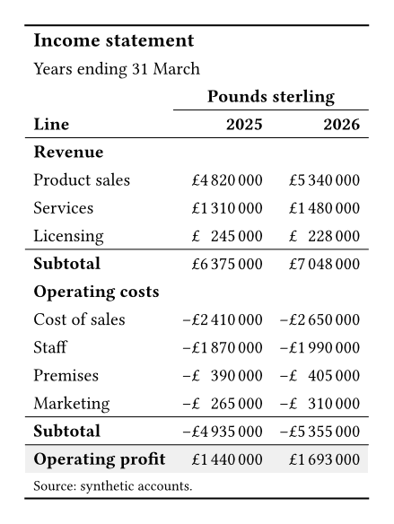

Annual accounts and management reports show results in this shape.
Both tables below start from the same data dictionary.

## The output

::: {layout-ncol=2}

{fig-alt="A booktabs table titled Income statement, with 2025 and 2026 columns under a Pounds sterling spanner. Revenue lines and Operating costs lines each end with a Subtotal row. A shaded Operating profit row closes the table."}

{fig-alt="The same income statement, built in native Typst, with the same sections, subtotals, and shaded operating profit row."}

:::

## What Keisen does for you

- Writes each amount in pounds sterling, with grouped digits and its sign.
- Calculates a subtotal for each section.
- Calculates the operating profit from all the rows.
- Shades the profit row through `cells-grand-summary`, so no cell gets its own fill.

## The source

:::: {.column-page layout-ncol=2}

::: {}

**Keisen**

```typst
#import "@preview/keisen:0.1.0": *

#let data = (
  section: ("Revenue",) * 3 + ("Operating costs",) * 4,
  line: (
    "Product sales",
    "Services",
    "Licensing",
    "Cost of sales",
    "Staff",
    "Premises",
    "Marketing",
  ),
  fy2025: (4820000, 1310000, 245000, -2410000, -1870000, -390000, -265000),
  fy2026: (5340000, 1480000, 228000, -2650000, -1990000, -405000, -310000),
)

#display-table(
  data,
  table-header(title: [Income statement], subtitle: [Years ending 31 March]),
  table-stub(rowname: "line", group: "section", label: [Line]),
  columns-label(fy2025: [2025], fy2026: [2026]),
  table-spanner([Pounds sterling], ("fy2025", "fy2026")),
  format-currency(("fy2025", "fy2026"), currency: "GBP", decimals: 0),
  summary-rows(functions: (Subtotal: aggregate-sum), columns: (
    "fy2025",
    "fy2026",
  )),
  grand-summary-rows(functions: ("Operating profit": aggregate-sum), columns: (
    "fy2025",
    "fy2026",
  )),
  table-style(style(fill: luma(240)), locations: cells-grand-summary()),
  table-source-note([Source: synthetic accounts.]),
  theme: theme-booktabs(),
)
```

:::

::: {}

**Native Typst**

```typst
#let data = (
  section: ("Revenue",) * 3 + ("Operating costs",) * 4,
  line: (
    "Product sales",
    "Services",
    "Licensing",
    "Cost of sales",
    "Staff",
    "Premises",
    "Marketing",
  ),
  fy2025: (4820000, 1310000, 245000, -2410000, -1870000, -390000, -265000),
  fy2026: (5340000, 1480000, 228000, -2650000, -1990000, -405000, -310000),
)

#let grouped(number) = {
  let digits = str(calc.abs(number))
  let groups = ()
  while digits.len() > 3 {
    groups.insert(0, digits.slice(-3))
    digits = digits.slice(0, -3)
  }
  groups.insert(0, digits)
  (if number < 0 { "−" } else { "" }) + groups.join(sym.space.thin)
}

#let pounds(number) = {
  let amount = grouped(calc.abs(number))
  (if number < 0 { "−" } else { "" }) + "£" + amount
}

#let years = ("fy2025", "fy2026")
#let body = ()
#for section in ("Revenue", "Operating costs") {
  let rows = range(data.line.len()).filter(row => (
    data.section.at(row) == section
  ))
  body.push(table.cell(colspan: 3, strong(section)))
  for row in rows {
    body.push(data.line.at(row))
    body += years.map(year => pounds(data.at(year).at(row)))
  }
  body.push(table.hline(stroke: 0.5pt))
  body.push([*Subtotal*])
  body += years.map(year => pounds(
    rows.map(row => data.at(year).at(row)).sum(),
  ))
}

#table(
  columns: 3,
  align: (start, end, end),
  stroke: none,
  inset: 0.45em,
  table.hline(stroke: 1pt),
  table.cell(colspan: 3, align: start, text(
    size: 1.1em,
    weight: "bold",
  )[Income statement]),
  table.cell(colspan: 3, align: start)[Years ending 31 March],
  table.header(
    [],
    table.cell(colspan: 2, align: center)[*Pounds sterling*],
    table.hline(start: 1, stroke: 0.5pt),
    [*Line*], [*2025*], [*2026*],
    table.hline(stroke: 0.5pt),
  ),
  ..body,
  table.hline(stroke: 0.5pt),
  table.cell(fill: luma(240))[*Operating profit*],
  ..years.map(year => table.cell(fill: luma(240), pounds(data.at(year).sum()))),
  table.cell(colspan: 3, align: start, text(
    size: 0.8em,
  )[Source: synthetic accounts.]),
  table.hline(stroke: 1pt),
)
```

:::

::::

## Learn more

- [Total a table by group](../examples/total-by-group.qmd).
- [Draw attention to a total](../examples/highlight-a-total.qmd).
- [Aggregations reference](../reference/aggregations.qmd).
- [Formatters reference](../reference/formatters.qmd).
- [Table parts reference](../reference/table-parts.qmd).
- [Themes reference](../reference/themes.qmd).
