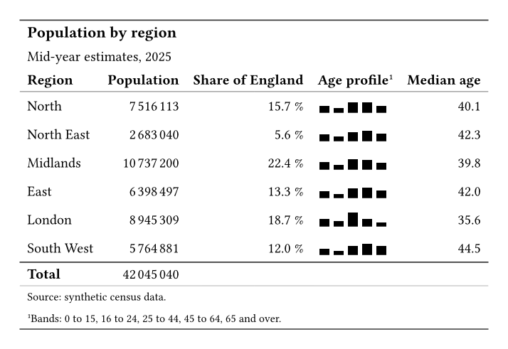
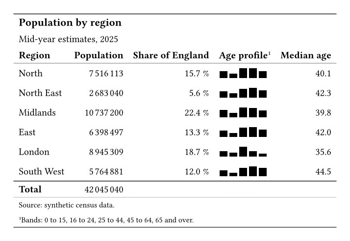

Census releases and regional reports summarise a population in this shape.
Both tables below start from the same data dictionary.

## The output

::: {layout-ncol=2}

{fig-alt="A table titled Population by region, with six regions. Each row shows a population with grouped digits, a share as a percentage, a small bar chart of five age bands, and a median age. A Total row closes the table."}

{fig-alt="The same population table, built in native Typst, with the same grouped counts, shares, bar charts, and total row."}

:::

## What Keisen does for you

- Groups the digits of each count with thin spaces.
- Scales each share to a percentage with one decimal place.
- Draws each age profile as a bar nanoplot.
- Calculates the total row from the data.

## The source

:::: {.column-page layout-ncol=2}

::: {}

**Keisen**

```typst
#import "@preview/keisen:0.1.0": *

#let data = (
  region: ("North", "North East", "Midlands", "East", "London", "South West"),
  population: (7516113, 2683040, 10737200, 6398497, 8945309, 5764881),
  share: (0.157, 0.056, 0.224, 0.133, 0.187, 0.120),
  profile: (
    (0.18, 0.12, 0.26, 0.26, 0.18),
    (0.17, 0.12, 0.24, 0.27, 0.20),
    (0.19, 0.12, 0.26, 0.25, 0.18),
    (0.18, 0.10, 0.25, 0.27, 0.20),
    (0.20, 0.14, 0.36, 0.20, 0.10),
    (0.16, 0.10, 0.23, 0.28, 0.23),
  ),
  median-age: (40.1, 42.3, 39.8, 42.0, 35.6, 44.5),
)

#display-table(
  data,
  table-header(
    title: [Population by region],
    subtitle: [Mid-year estimates, 2025],
  ),
  table-stub(rowname: "region", label: [Region]),
  columns-label(
    population: [Population],
    share: [Share of England],
    profile: [Age profile],
    median-age: [Median age],
  ),
  format-integer("population"),
  format-percent("share", decimals: 1),
  format-number("median-age", decimals: 1),
  format-nanoplot(
    "profile",
    plot: nanoplot-bar,
    width: 5em,
    height: 1em,
    baseline: 25%,
  ),
  grand-summary-rows(functions: (Total: aggregate-sum), columns: (
    "population",
  )),
  table-footnote(
    [Bands: 0 to 15, 16 to 24, 25 to 44, 45 to 64, 65 and over.],
    locations: cells-column-labels(columns: "profile"),
  ),
  table-source-note([Source: synthetic census data.]),
  table-options(cell-vertical-align: horizon),
)
```

:::

::: {}

**Native Typst**

```typst
#let data = (
  region: ("North", "North East", "Midlands", "East", "London", "South West"),
  population: (7516113, 2683040, 10737200, 6398497, 8945309, 5764881),
  share: (0.157, 0.056, 0.224, 0.133, 0.187, 0.120),
  profile: (
    (0.18, 0.12, 0.26, 0.26, 0.18),
    (0.17, 0.12, 0.24, 0.27, 0.20),
    (0.19, 0.12, 0.26, 0.25, 0.18),
    (0.18, 0.10, 0.25, 0.27, 0.20),
    (0.20, 0.14, 0.36, 0.20, 0.10),
    (0.16, 0.10, 0.23, 0.28, 0.23),
  ),
  median-age: (40.1, 42.3, 39.8, 42.0, 35.6, 44.5),
)

#let fixed(value, digits) = {
  let text = str(calc.round(value, digits: digits))
  let parts = text.split(".")
  let decimals = parts.at(1, default: "")
  parts.at(0) + "." + decimals + "0" * (digits - decimals.len())
}

#let grouped(number) = {
  let digits = str(calc.abs(number))
  let groups = ()
  while digits.len() > 3 {
    groups.insert(0, digits.slice(-3))
    digits = digits.slice(0, -3)
  }
  groups.insert(0, digits)
  (if number < 0 { "-" } else { "" }) + groups.join(sym.space.thin)
}

#let bars(values) = {
  let peak = calc.max(..values)
  let width = 5em / values.len()
  box(width: 5em, height: 1em, baseline: 25%, stack(
    dir: ltr,
    ..values.map(value => box(width: width, height: 1em, align(
      bottom + center,
      rect(
        width: width * 0.8,
        height: 1em * value / peak,
        fill: black,
        stroke: none,
      ),
    ))),
  ))
}

#let body = ()
#for row in range(data.region.len()) {
  body += (
    data.region.at(row),
    grouped(data.population.at(row)),
    fixed(data.share.at(row) * 100, 1) + " %",
    bars(data.profile.at(row)),
    fixed(data.median-age.at(row), 1),
  )
}

#table(
  columns: 5,
  align: (
    start + horizon,
    end + horizon,
    end + horizon,
    start + horizon,
    end + horizon,
  ),
  stroke: none,
  inset: 0.5em,
  table.hline(stroke: 0.8pt + luma(60)),
  table.cell(colspan: 5, align: start, text(
    size: 1.1em,
    weight: "bold",
  )[Population by region]),
  table.cell(colspan: 5, align: start)[Mid-year estimates, 2025],
  table.header(
    [*Region*],
    [*Population*],
    [*Share of England*],
    [*Age profile*#super[1]],
    [*Median age*],
    table.hline(stroke: 0.5pt + luma(120)),
  ),
  ..body,
  table.hline(stroke: 0.8pt + luma(60)),
  [*Total*], grouped(data.population.sum()), [], [], [],
  table.hline(stroke: 0.5pt + luma(180)),
  table.cell(colspan: 5, align: start, text(
    size: 0.8em,
  )[Source: synthetic census data.]),
  table.cell(colspan: 5, align: start, text(size: 0.8em)[
    #super[1]Bands: 0 to 15, 16 to 24, 25 to 44, 45 to 64, 65 and over.
  ]),
  table.hline(stroke: 0.8pt + luma(60)),
)
```

:::

::::

## Learn more

- [Show a trend inside a cell](../examples/trend-inside-a-cell.qmd).
- [Total a table by group](../examples/total-by-group.qmd).
- [Nanoplots reference](../reference/nanoplots.qmd).
- [Aggregations reference](../reference/aggregations.qmd).
