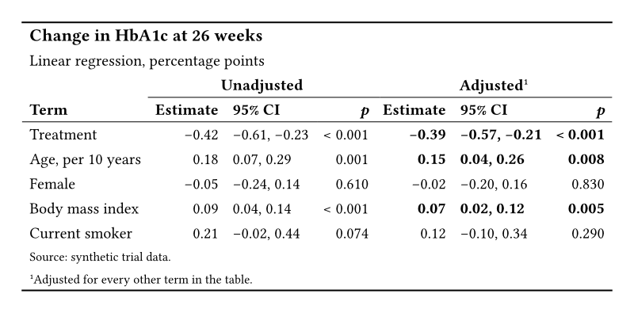

Results sections and supplementary tables show regression models in this shape.
Both tables below start from the same data dictionary.

## The output

::: {layout-ncol=2}

{fig-alt="A booktabs table titled Change in HbA1c at 26 weeks. Unadjusted and Adjusted spanners each cover an Estimate, a 95% CI, and a p column for five terms. Small p-values show as less than 0.001, and the adjusted results with p below 0.05 are in bold."}

{fig-alt="The same regression table, built in native Typst, with the same spanners, intervals, p-values, and bold rows."}

:::

## What Keisen does for you

- Rounds the estimates and the interval bounds to two decimal places.
- Writes a p-value below 0.001 as `< 0.001` through one directive for each column, chosen by a predicate on the rows.
- Sets the significant adjusted results in bold from one predicate on the data, so no cell is wrapped by hand.
- Puts one spanner over the three columns of each model.

## The source

:::: {.column-page layout-ncol=2}

::: {}

**Keisen**

```typst
#import "@preview/keisen:0.1.0": *

#let data = (
  term: (
    "Treatment",
    "Age, per 10 years",
    "Female",
    "Body mass index",
    "Current smoker",
  ),
  crude: (-0.42, 0.18, -0.05, 0.09, 0.21),
  crude-lower: (-0.61, 0.07, -0.24, 0.04, -0.02),
  crude-upper: (-0.23, 0.29, 0.14, 0.14, 0.44),
  crude-p: (0.000021, 0.0012, 0.61, 0.00034, 0.074),
  adjusted: (-0.39, 0.15, -0.02, 0.07, 0.12),
  adjusted-lower: (-0.57, 0.04, -0.20, 0.02, -0.10),
  adjusted-upper: (-0.21, 0.26, 0.16, 0.12, 0.34),
  adjusted-p: (0.000038, 0.0081, 0.83, 0.0049, 0.29),
)

#display-table(
  data,
  table-header(
    title: [Change in HbA1c at 26 weeks],
    subtitle: [Linear regression, percentage points],
  ),
  table-stub(rowname: "term", label: [Term]),
  format-number(
    name => name != "term" and not name.ends-with("-p"),
    decimals: 2,
  ),
  format-number(name => name.ends-with("-p"), decimals: 3),
  format("crude-p", value => [< 0.001], rows: row => row.crude-p < 0.001),
  format("adjusted-p", value => [< 0.001], rows: row => row.adjusted-p < 0.001),
  columns-combine(
    "crude-interval",
    ("crude-lower", "crude-upper"),
    (low, high) => [#low, #high],
    label: [95% CI],
  ),
  columns-combine(
    "adjusted-interval",
    ("adjusted-lower", "adjusted-upper"),
    (low, high) => [#low, #high],
    label: [95% CI],
  ),
  columns-label(
    crude: [Estimate],
    crude-p: [_p_],
    adjusted: [Estimate],
    adjusted-p: [_p_],
  ),
  table-spanner([Unadjusted], ("crude", "crude-interval", "crude-p")),
  table-spanner([Adjusted], ("adjusted", "adjusted-interval", "adjusted-p")),
  table-style(
    style(text: (weight: "bold")),
    locations: cells-body(
      columns: ("adjusted", "adjusted-interval", "adjusted-p"),
      rows: row => row.adjusted-p < 0.05,
    ),
  ),
  table-footnote(
    [Adjusted for every other term in the table.],
    locations: cells-column-spanners(spanners: [Adjusted]),
  ),
  table-source-note([Source: synthetic trial data.]),
  theme: theme-booktabs(),
)
```

:::

::: {}

**Native Typst**

```typst
#let data = (
  term: (
    "Treatment",
    "Age, per 10 years",
    "Female",
    "Body mass index",
    "Current smoker",
  ),
  crude: (-0.42, 0.18, -0.05, 0.09, 0.21),
  crude-lower: (-0.61, 0.07, -0.24, 0.04, -0.02),
  crude-upper: (-0.23, 0.29, 0.14, 0.14, 0.44),
  crude-p: (0.000021, 0.0012, 0.61, 0.00034, 0.074),
  adjusted: (-0.39, 0.15, -0.02, 0.07, 0.12),
  adjusted-lower: (-0.57, 0.04, -0.20, 0.02, -0.10),
  adjusted-upper: (-0.21, 0.26, 0.16, 0.12, 0.34),
  adjusted-p: (0.000038, 0.0081, 0.83, 0.0049, 0.29),
)

#let fixed(value, digits) = {
  let text = str(calc.round(value, digits: digits))
  let parts = text.split(".")
  let decimals = parts.at(1, default: "")
  parts.at(0) + "." + decimals + "0" * (digits - decimals.len())
}

#let p-value(p) = if p < 0.001 { [< 0.001] } else { fixed(p, 3) }

#let body = ()
#for row in range(data.term.len()) {
  body.push(data.term.at(row))
  for model in ("crude", "adjusted") {
    let cells = (
      fixed(data.at(model).at(row), 2),
      fixed(data.at(model + "-lower").at(row), 2)
        + ", "
        + fixed(data.at(model + "-upper").at(row), 2),
      p-value(data.at(model + "-p").at(row)),
    )
    if model == "adjusted" and data.adjusted-p.at(row) < 0.05 {
      cells = cells.map(cell => strong(cell))
    }
    body += cells
  }
}

#table(
  columns: 7,
  align: (start, end, start, end, end, start, end),
  stroke: none,
  inset: 0.45em,
  table.hline(stroke: 1pt),
  table.cell(colspan: 7, align: start, text(
    size: 1.1em,
    weight: "bold",
  )[Change in HbA1c at 26 weeks]),
  table.cell(colspan: 7, align: start)[Linear regression, percentage points],
  table.header(
    [],
    table.cell(colspan: 3, align: center)[*Unadjusted*],
    table.cell(colspan: 3, align: center)[*Adjusted*#super[1]],
    table.hline(start: 1, end: 4, stroke: 0.5pt),
    table.hline(start: 4, stroke: 0.5pt),
    [*Term*],
    [*Estimate*],
    [*95% CI*],
    [*_p_*],
    [*Estimate*],
    [*95% CI*],
    [*_p_*],
    table.hline(stroke: 0.5pt),
  ),
  ..body,
  table.cell(colspan: 7, align: start, text(
    size: 0.8em,
  )[Source: synthetic trial data.]),
  table.cell(colspan: 7, align: start, text(
    size: 0.8em,
  )[#super[1]Adjusted for every other term in the table.]),
  table.hline(stroke: 1pt),
)
```

:::

::::

## Learn more

- [Report an estimate with its error](../examples/estimate-with-its-error.qmd).
- [Mark a cell that fails a threshold](../examples/mark-a-failing-cell.qmd).
- [Formatters reference](../reference/formatters.qmd).
- [Locations reference](../reference/locations.qmd).
- [Table parts reference](../reference/table-parts.qmd).
- [Themes reference](../reference/themes.qmd).
