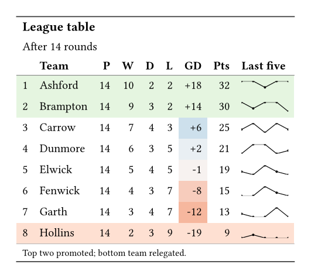
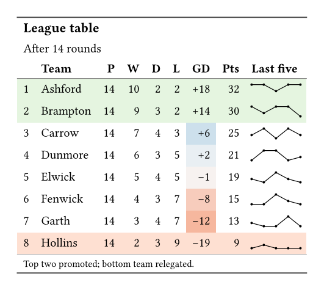

Sports pages and club websites print a league table in this shape.
Both tables below start from the same data dictionary.

## The output

::: {layout-ncol=2}

{fig-alt="A table titled League table, with eight teams. The goal difference cells are coloured from red for negative to blue for positive. A small line chart shows the last five results, and the top two rows are green and the bottom row red."}

{fig-alt="The same league table, built in native Typst, with the same colours, form charts, and shaded rows."}

:::

## What Keisen does for you

- Colours the goal difference on one scale for the whole column.
- Draws the last five results as a points nanoplot.
- Writes a plus sign before each positive goal difference.
- Shades the promotion and relegation rows by position.

## The source

:::: {.column-page layout-ncol=2}

::: {}

**Keisen**

```typst
#import "@preview/keisen:0.1.0": *

#let data = (
  position: (1, 2, 3, 4, 5, 6, 7, 8),
  team: (
    "Ashford",
    "Brampton",
    "Carrow",
    "Dunmore",
    "Elwick",
    "Fenwick",
    "Garth",
    "Hollins",
  ),
  played: (14,) * 8,
  won: (10, 9, 7, 6, 5, 4, 3, 2),
  drawn: (2, 3, 4, 3, 4, 3, 4, 3),
  lost: (2, 2, 3, 5, 5, 7, 7, 9),
  difference: (18, 14, 6, 2, -1, -8, -12, -19),
  points: (32, 30, 25, 21, 19, 15, 13, 9),
  form: (
    (3, 3, 1, 3, 3),
    (3, 1, 3, 3, 0),
    (1, 3, 0, 3, 1),
    (0, 3, 3, 0, 1),
    (1, 0, 3, 1, 0),
    (0, 0, 3, 1, 0),
    (1, 0, 0, 3, 0),
    (0, 1, 0, 0, 0),
  ),
)

#display-table(
  data,
  table-header(title: [League table], subtitle: [After 14 rounds]),
  columns-label(
    position: [],
    team: [Team],
    played: [P],
    won: [W],
    drawn: [D],
    lost: [L],
    difference: [GD],
    points: [Pts],
    form: [Last five],
  ),
  format-integer("difference", sign: true),
  format-nanoplot(
    "form",
    plot: nanoplot-points,
    width: 4em,
    height: 0.8em,
    domain: (0, 3),
  ),
  table-style(style(fill: rgb("#e5f5e0")), locations: cells-body(rows: (0, 1))),
  table-style(style(fill: rgb("#fee0d2")), locations: cells-body(rows: (7,))),
  data-colour(
    ("#ef8a62", "#f7f7f7", "#67a9cf"),
    columns: "difference",
    domain: (-20, 20),
  ),
  table-source-note([Top two promoted; bottom team relegated.]),
)
```

:::

::: {}

**Native Typst**

```typst
#let data = (
  position: (1, 2, 3, 4, 5, 6, 7, 8),
  team: (
    "Ashford",
    "Brampton",
    "Carrow",
    "Dunmore",
    "Elwick",
    "Fenwick",
    "Garth",
    "Hollins",
  ),
  played: (14,) * 8,
  won: (10, 9, 7, 6, 5, 4, 3, 2),
  drawn: (2, 3, 4, 3, 4, 3, 4, 3),
  lost: (2, 2, 3, 5, 5, 7, 7, 9),
  difference: (18, 14, 6, 2, -1, -8, -12, -19),
  points: (32, 30, 25, 21, 19, 15, 13, 9),
  form: (
    (3, 3, 1, 3, 3),
    (3, 1, 3, 3, 0),
    (1, 3, 0, 3, 1),
    (0, 3, 3, 0, 1),
    (1, 0, 3, 1, 0),
    (0, 0, 3, 1, 0),
    (1, 0, 0, 3, 0),
    (0, 1, 0, 0, 0),
  ),
)

#let form(results) = {
  let step = 4em / (results.len() - 1)
  let points = results
    .enumerate()
    .map(((index, value)) => (index * step, 0.8em * (1 - value / 3)))
  box(width: 4em, height: 0.8em, {
    place(curve(
      stroke: 0.6pt,
      curve.move(points.first()),
      ..points.slice(1).map(point => curve.line(point)),
    ))
    for point in points {
      place(dx: point.at(0) - 1pt, dy: point.at(1) - 1pt, circle(
        radius: 1pt,
        fill: black,
        stroke: none,
      ))
    }
  })
}

#let shade(difference) = {
  let scale = gradient.linear(rgb("#ef8a62"), rgb("#f7f7f7"), rgb("#67a9cf"))
  scale.sample((difference + 20) / 40 * 100%)
}

#let last = data.team.len() - 1
#let body = ()
#for row in range(data.team.len()) {
  let zone = if row < 2 { rgb("#e5f5e0") } else if row == last {
    rgb("#fee0d2")
  } else { none }
  let difference = data.difference.at(row)
  let signed = if difference > 0 { "+" + str(difference) } else {
    str(difference)
  }
  body += (
    str(data.position.at(row)),
    data.team.at(row),
    ..("played", "won", "drawn", "lost").map(column => str(
      data.at(column).at(row),
    )),
    table.cell(
      fill: if zone == none { shade(difference) } else { zone },
      signed,
    ),
    str(data.points.at(row)),
    form(data.form.at(row)),
  ).map(cell => if type(cell) == content and cell.func() == table.cell {
    cell
  } else { table.cell(fill: zone, cell) })
}

#table(
  columns: 9,
  align: (start, start, end, end, end, end, end, end, start),
  stroke: none,
  inset: 0.5em,
  table.hline(stroke: 0.8pt + luma(60)),
  table.cell(colspan: 9, align: start, text(
    size: 1.1em,
    weight: "bold",
  )[League table]),
  table.cell(colspan: 9, align: start)[After 14 rounds],
  table.header(
    [], [*Team*], [*P*], [*W*], [*D*], [*L*], [*GD*], [*Pts*], [*Last five*],
    table.hline(stroke: 0.5pt + luma(120)),
  ),
  ..body,
  table.hline(stroke: 0.5pt + luma(180)),
  table.cell(colspan: 9, align: start, text(
    size: 0.8em,
  )[Top two promoted; bottom team relegated.]),
  table.hline(stroke: 0.8pt + luma(60)),
)
```

:::

::::

## Learn more

- [Show a trend inside a cell](../examples/trend-inside-a-cell.qmd).
- [Mark a cell that fails a threshold](../examples/mark-a-failing-cell.qmd).
- [Nanoplots reference](../reference/nanoplots.qmd).
- [Locations reference](../reference/locations.qmd).
