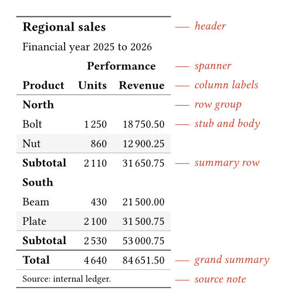

::: {.keisen-hero}

::: {.keisen-hero-text}

::: {.keisen-brand}

```{=html}

```

# Keisen [罫線]{.keisen-kanji lang="ja"} {.keisen-wordmark .unnumbered .unlisted .no-anchor}

:::

[Display tables for Typst, built from data rather than drawn by hand.]{.keisen-tagline}

Describe the parts and the formatting, and Keisen does the bookkeeping: subtotals, spanners, footnote marks, and numbers aligned on the decimal point.
_Keisen_ (罫線) is Japanese for the ruled lines of a table.

[Early development: use from a clone]{.keisen-badge}

[See the gallery](gallery/index.qmd){.btn .btn-primary}
[Browse examples](examples/index.qmd){.btn .btn-outline-primary}

:::

::: {.keisen-anatomy}

{fig-alt="A sales table titled Regional sales with each part named in red in the right margin: header, spanner, column labels, row group, stub and body, summary row, grand summary, and source note."}

:::

:::

## Six domains, each built twice

Each gallery entry builds one table with Keisen and again in native Typst, from the same data.

::: {#gallery-strip}
:::

## Keisen and native Typst

A Keisen table isn't much shorter than the same table in native Typst, and the gallery shows both side by side.
The difference is what the lines say.
Native code says how to build the table: loop over the sections, sum each column, and put each rule in its place.
Keisen says what the table is, so when the data changes, the table follows.
Add a section, a third year or another line, and there's no code to touch.

```{.typst filename="Native Typst"}
#for section in ("Revenue", "Operating costs") {
  let rows = range(data.line.len()).filter(row => (
    data.section.at(row) == section
  ))
  body.push(table.cell(colspan: 3, strong(section)))
  for row in rows {
    body.push(data.line.at(row))
    body += years.map(year => pounds(data.at(year).at(row)))
  }
  body.push(table.hline(stroke: 0.5pt))
  body.push([*Subtotal*])
  body += years.map(year => pounds(
    rows.map(row => data.at(year).at(row)).sum(),
  ))
}
```

```{.typst filename="Keisen"}
#display-table(
  data,
  table-header(title: [Income statement], subtitle: [Years ending 31 March]),
  table-stub(rowname: "line", group: "section", label: [Line]),
  columns-label(fy2025: [2025], fy2026: [2026]),
  table-spanner([Pounds sterling], ("fy2025", "fy2026")),
  format-currency(("fy2025", "fy2026"), currency: "GBP", decimals: 0),
  summary-rows(functions: (Subtotal: aggregate-sum), columns: (
    "fy2025",
    "fy2026",
  )),
  grand-summary-rows(functions: ("Operating profit": aggregate-sum), columns: (
    "fy2025",
    "fy2026",
  )),
  table-style(style(fill: luma(240)), locations: cells-grand-summary()),
  table-source-note([Source: synthetic accounts.]),
  theme: theme-booktabs(),
)
```

Both come from the [income statement](gallery/income-statement.qmd).
The first is the loop that builds the body of the native table.
The rest of that file places the header, the rules and the total, and brings its own helpers to group the digits and print the pounds.
The second is the whole Keisen table.

Keisen also looks after the details that are easy to get wrong.
Sums stay exact because they run in decimals, footnote marks are numbered in reading order, a group's label comes back after a page break, and negative numbers get a true minus sign.
A theme is a value too, so you can define your house style once and pass it to every table in a report.

## The grammar

Keisen implements the display-table grammar that R's [`gt`](https://gt.rstudio.com) and Python's [`great_tables`](https://posit-dev.github.io/great-tables/) made familiar, designed for Typst rather than ported to it.

::: {.keisen-grammar}

| Layer      | What it gives you                                                                                                                    |
| ---------- | ------------------------------------------------------------------------------------------------------------------------------------ |
| Parts      | A header, a stub with row names and groups, column labels with spanners, summary rows, source notes, and footnotes numbered in reading order. |
| Formatters | Numbers, percentages, currency, scientific notation, byte sizes, dates, and markup, computed in Typst's `decimal` type rather than in floats. |
| Locations  | Styling addressed by what the data says, so a cell is highlighted because its margin fell below a threshold, not because it is in row nine. |
| Nanoplots  | Sparklines and bars inside cells, sharing one domain down a column so they can be compared.                                           |
| Themes     | Four presets that are option dictionaries, so a theme and an option call compose by merging.                                        |

:::

## Quick look

::: {.keisen-quick-look}

::: {.keisen-quick-look-code}

The table at the top of this page comes from this call, with each part labelled.

```typst
#import "@preview/keisen:0.1.0": *

#display-table(
  (
    product: ("Bolt", "Nut", "Beam", "Plate"),
    region: ("North", "North", "South", "South"),
    units: (1250, 860, 430, 2100),
    revenue: (18750.5, 12900.25, 21500, 31500.75),
  ),
  table-header(title: [Regional sales], subtitle: [Financial year 2025 to 2026]),
  table-stub(rowname: "product", group: "region", label: [Product]),
  columns-label(units: [Units], revenue: [Revenue]),
  table-spanner([Performance], ("units", "revenue")),
  format-integer("units"),
  format-number("revenue", decimals: 2),
  summary-rows(functions: (Subtotal: aggregate-sum), columns: ("units", "revenue")),
  grand-summary-rows(functions: (Total: aggregate-sum), columns: ("units", "revenue")),
  table-source-note([Source: internal ledger.]),
  table-options(row-striping: true),
)
```

:::

::: {.keisen-quick-look-notes}

### No dependencies {.no-anchor}

Keisen imports no third-party package, so formatting stays pluggable and installing it pulls in nothing else.

### Native row groups {.no-anchor}

Row groups are native repeating subheaders, so a group that spans a page break prints its label again.

### Status {.no-anchor}

Until the first release, use Keisen from a clone of the repository.
The API settles milestone by milestone.
Follow the [issue tracker](https://github.com//issues), or read the [changelog](changelog.qmd).

:::

:::
